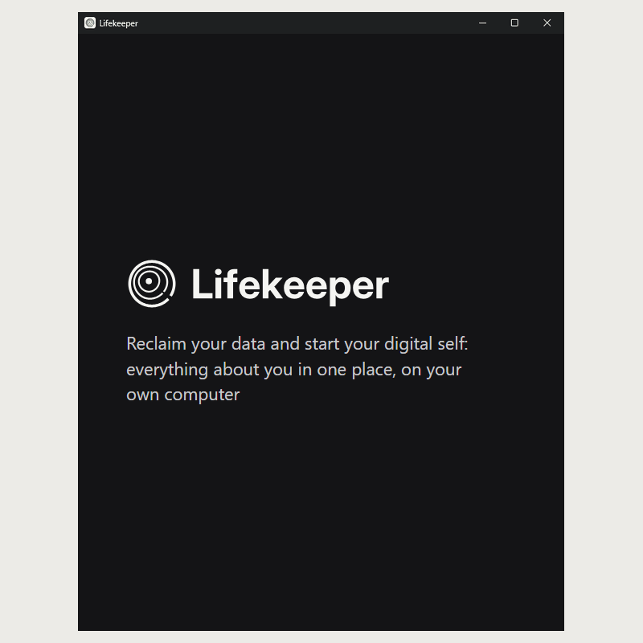

<p align="center">
  <picture>
    <source media="(prefers-color-scheme: dark)" srcset="docs/images/lockup-dark.svg">
    
  </picture>
</p>

<h3 align="center">Reclaim your data and start your digital self: everything about you in one place, on your own computer</h3>

<p align="center">
  <a href="https://github.com/claudiakitova/lifekeeper/actions/workflows/tests.yml"></a>
  <a href="https://github.com/claudiakitova/lifekeeper/releases/latest"></a>
  <a href="LICENSE"></a>
</p>

Your photos, chats and posts are held by a dozen companies, and you only see them through their apps. Lifekeeper is how you take them back and put them together into one archive that you own and can read, search and correct.

<p align="center"></p>

## Make your page

Lifekeeper reads a folder of exports and writes one HTML page: your life by year and month, with where you were, who you talked to, and what you posted, listened to, read and watched. This part works offline and sends nothing anywhere.

It reads photos, Telegram, WhatsApp, Messenger and Instagram chats, Android texts, sent Gmail, Google location history, Facebook, Instagram and X posts, Instagram stories, your comments, calendars, Google Keep, LinkedIn, Spotify, YouTube, Netflix, Goodreads, Google searches, ChatGPT chats, time trackers, mood diaries, Flo, and notes you write yourself. Zips can stay zipped. [Details](toolkit/lifekeeper/).

### The app (Windows, Mac)

1. Download it from [Releases](https://github.com/claudiakitova/lifekeeper/releases) and unzip.
2. Double-click it, choose the folder with your exports, and press "Make my page".
3. The page opens in your browser.
4. To ask a question about your life, type it in the same window.

The app isn't signed, so the first time your computer asks before running it:
- Windows: "Windows protected your PC" → **More info** → **Run anyway**.
- Mac: right-click the app → **Open** → **Open**.

### The script

Install it with [pipx](https://pipx.pypa.io) (Python 3.10 or newer):

```
pipx install lifekeeper
lifekeeper path/to/your/exports --out my-life.html
lifekeeper-ask path/to/your/exports "When did I meet Leo?"
lifekeeper-app    # the window
lifekeeper-faces scan path/to/your/exports    # find the people in your photos
```

Or run it from a copy of this repository. It needs Python 3.10 or newer and nothing else. With Pillow (`pip install pillow`), it also reads the dates and places stored inside photos.

Try it on the made-up [demo](demo/) data:

```
python toolkit/lifekeeper/lifekeeper.py demo/exports --out demo/life.html
```

Then on your own exports:

```
python toolkit/lifekeeper/lifekeeper.py path/to/your/exports --out my-life.html
```

## People in your photos

Lifekeeper can find the faces in your photos, group the same person across photos, and let you name each group once. After that, your page shows who is in your photos each month, and you can ask about them. It runs on your computer with OpenCV's face models; no photo leaves it. In the app, press **Find faces** after making your page. [Details](toolkit/lifekeeper/#people-in-your-photos).

## Places and trips

Photos with a location, and Google location history, are named by town, using [GeoNames](https://www.geonames.org/). Lifekeeper works out where home was each month and lists the trips away from it, with the places, days and photos. If it gets home wrong, write where you lived in `my_homes.csv`. [Details](toolkit/lifekeeper/#places-and-trips).

## Ask a question

Ask a question about your life and get an answer from your own records, with the records it used. In the app, type it under "Ask a question". With the script:

```
python toolkit/lifekeeper/ask.py path/to/your/exports "When did I meet Leo?"
```

With no AI, it shows the records that match, and nothing leaves your computer. For a written answer, add a model you choose: one on your own computer (`--ollama gemma3`) or Google Gemini with your own key (`--gemini`). Every sentence of an answer has to cite a record, and a sentence with a date or number that isn't in its records is left out. [Details](toolkit/lifekeeper/#ask-a-question).

## Getting your data

- [How to download it](docs/download-your-data/), step by step.
- [Every source I know of](docs/sources.md), and which ones Lifekeeper reads.
- [How much to collect](docs/collecting.md). An afternoon is enough to start.

## The method

- [The approach](docs/approach.md): ten steps, and what went wrong while I built a 20-year archive.
- [Start small](docs/start-small.md): a first week.
- [Privacy](docs/privacy.md) and [encrypted backup](docs/backup.md).
- [Readable on a hard day](docs/readable-on-a-hard-day.md): how I write pages so they're easy to read when I'm tired or unwell.
- [What it's useful for](docs/uses.md), including [memory loss](docs/memory-loss.md) (with sources).
- [Why not just give an AI access to my accounts?](docs/why-not-just-connect-ai.md)
- [Similar projects](docs/alternatives.md).
- [Claude Code skills](skills/) that build and review an archive with you.

## Rules I follow

1. Original files are never changed. Everything else is made from them and can be rebuilt.
2. What I say about my own life beats what a program worked out. My corrections survive every re-import.
3. Every fact links to the record it came from.
4. Pages use plain words and real dates. Nothing technical.
5. Data stays on my computer unless I decide to send it somewhere.
6. Open formats, encrypted backups in more than one place, and a restore I've tested.

## Status

Lifekeeper is the public part of the archive I use for my own life. Mine also reads scans and voice recordings, describes what's in each photo, and has more views of the same data. I'm moving those parts into Lifekeeper one at a time.

## About

Made by [Claudia Kitova](https://github.com/claudiakitova). [MIT License](LICENSE). To contribute, see [CONTRIBUTING](CONTRIBUTING.md).
